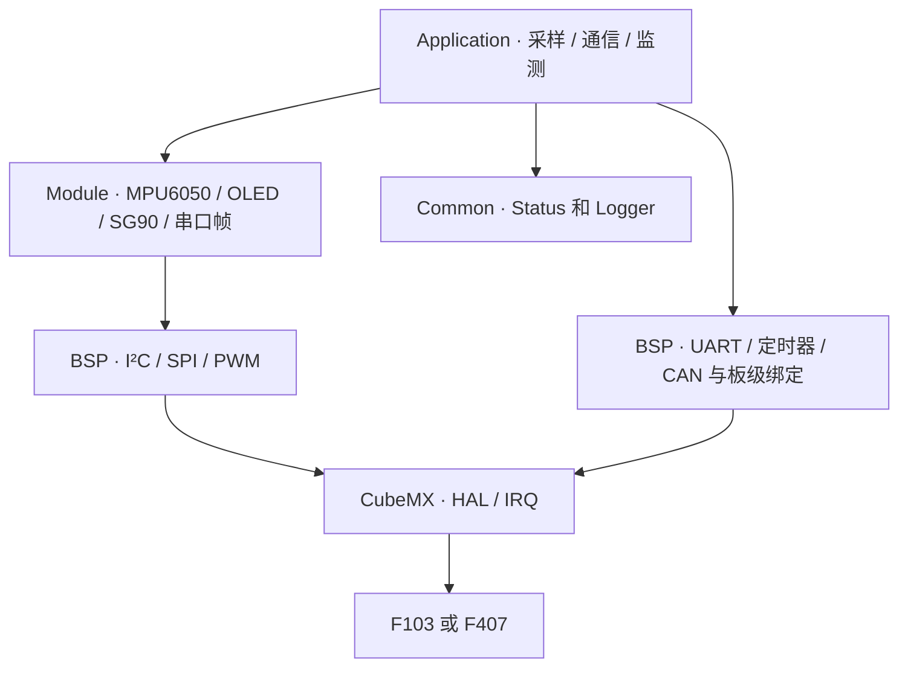

# 架构与接口

仓库根目录的 Application、Module、BSP 和 Common 为手写代码，boards 下为每款 MCU 的 .ioc、生成文件、链接脚本、CMake 和 Ozone 工程。两板在 CubeMX 中配置 Comm，由生成任务通过 C 入口 Framework_Run 进入 C++。F103 的 Sensor、Monitor、请求队列和事件队列也由 CubeMX 在调度前创建；工作任务在 Comm 完成定时器与串口准备后被唤醒。CMake 仅给 F103 链入完整物料和设备任务，F407 运行同一串口帧和 TIM2 调用链。

| 接口 | 使用及资源所有权 |
| --- | --- |
| Uart、FrameParser、Logger | Comm 独占串口，用阻塞发送写入简短应答和错误，用中断环形缓冲持续收包。BSP 的定长中断收发使用最多 128 字节内部缓冲，start 后由 poll/cancel 回收结果。流式接收保留字节到达时间，供半帧超时判断。 |
| Timer、PwmChannel、Sg90 | TIM2 有限时轮询和周期 IRQ。TIM3 两个通道共用更新事件，Comm 串行确认舵机目标更新；单次操作得到最终状态后再更新另一通道。 |
| I²C、SPI | 7 位 I²C 地址，HAL 内部换算。启动中断事务时复制发送数据并返回票号；wait 等待最终状态，cancel 或 recover 清理未完成操作。采样交给 Sensor，屏幕刷新由 Comm 发起。 |
| CAN | 支持标准 11 位数据帧、DLC 0~8。在两种模式中都检查最终邮箱状态；中断接收使用定长队列，溢出通过状态码上报。 |
| 错误和早期故障 | 正常运行时由 Logger 输出模块、Status 和上下文。时钟或 CubeMX 初始化失败发生在调度前，Ozone 可查 framework_fault_file、framework_fault_line。 |

## FreeRTOS

| 任务 | 初始优先级 / 栈 | 运行方式与通信 | 这样划分的原因 |
| --- | --- | --- | --- |
| Sensor，仅 F103 | AboveNormal / 1024 B | 每 20 ms 采样，接收 4 项命令队列的请求，向 Comm 交付样本及错误。后台样本供 OLED 使用，串口按命令返回六轴数据 | 优先保证采样周期。采样失败后等待重新初始化。 |
| Comm，双板 | Normal / 1024 B | 接收中断或事件队列置位唤醒；在帧间超时处检查解析器；唯一日志写入者 | 保持字节与帧顺序，防止多个任务交错输出。 |
| Monitor，仅 F103 | BelowNormal / 1024 B | 每秒更新监测状态，Comm 收到命令 05 后输出当前资源余量及累计错误数 | 将周期观测留在后台，按需使用串口带宽。 |

F103 的 FreeRTOS 堆为 10 KiB。链接器报告包含预留堆，运行期余量通过 `0x05` 读取。F407 的同一命令给出 Comm 剩余栈和日志写失败次数。ISR 搬运数据、发布状态或唤醒任务。
