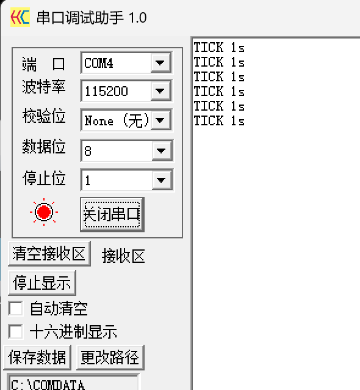

# F103 首次上板

## 接线与下载

先核对板载 HSE 标注为 8 MHz，BOOT0 置低，开发板正常供电。J-Link 通过 SWD 接板：VTref 接板上 3.3 V 用于检测目标电压，GND 共地，SWDIO 接 PA13，SWCLK 接 PA14，有复位脚时接 NRST。USB-TTL 使用 3.3 V 逻辑，RX 接 PA9、TX 接 PA10、GND 共地。开发板已有供电时只连串口信号和地。

在基线提交下构建 Debug ELF，用板卡目录中的 Ozone 工程打开 ELF，通过 J-Link 下载。Ozone 选择 SWD，复位后按 F5 连续运行。串口先打开 115200、8N1、无流控，再复位一次以捕获首行。本次不用接传感器、显示屏、舵机或 CAN 收发器。

| 用例 | 预期 | 实测 |
| --- | --- | --- |
| J-Link 下载与校验 | 目标识别正确，Ozone 下载完成 | 待回传 |
| 复位与调度 | 首行 F103 BASELINE READY，此后约每秒一行 TICK 1s | 心跳已实测，启动首行和实际间隔待记录 |
| 断点检查 | 在 Framework_Run 内暂停可读取 fwHeartbeat；连续运行后再暂停应递增，fwBootTxErrors 为 0 | 待回传 |

请回传板卡型号、晶振标识、Ozone 的连接/下载结果，以及从复位开始至少 5 秒的串口原始文本。出现异常时保留原有输出、PC 所在函数或 Ozone 报错。调试器暂停期间的时间间隔不计入周期测量。

## 在工程目录打开基线

用 Ozone 打开 [F103 基线工程](../boards/f103/f103-baseline.jdebug)，它加载同目录下的 `build/baseline/f103.elf`。从 Ozone 的固件选择框也可以直接选这份 ELF。基线源码版本为 `57aa484`，可在 `Framework_Run` 设置断点。

首次从 GitHub 克隆后，在仓库根目录用 PowerShell 执行以下命令生成基线。第一行只需执行一次。源码工作树与构建产物都在本工程的 build 目录中，当前主线可以继续开发。

```powershell
git worktree add --detach build/baseline-src 57aa484
$baselineOutput = Join-Path (Get-Location) 'boards/f103/build/baseline'
Push-Location build/baseline-src/boards/f103
cmake --preset Debug -B $baselineOutput
cmake --build $baselineOutput
Pop-Location
```

## 2026-11-13 · COM4 心跳实测

使用步骤 2 的 F103 基线 `57aa484` 复测。串口助手显示 COM4 已打开，115200、无校验、8 数据位、1 停止位。接收区连续可见 6 行 `TICK 1s`。结合基线任务中循环发送心跳的代码，这次验证了 F103 的任务能重复运行，USART1 TX 到电脑的接收链路可用。

截图未包含复位后的首行、接收时间戳、Ozone 下载输出和断点变量。实际心跳周期与串口接收方向分别留待有对应记录时确认。


