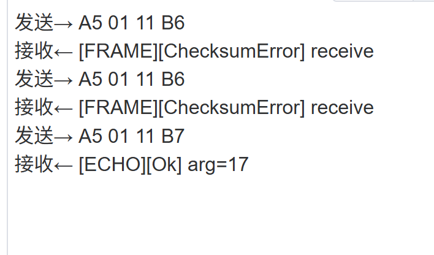

# 串口协议与验证

USART1 为 115200、8N1。每个命令为四字节 `A5 CMD ARG SUM`，SUM 取前三字节相加的低八位。例如回送 17 发送 `A5 01 11 B7`。回复为可直接保存的 ASCII 行。常规接收使用中断环形缓冲区，每个字节带有到达时间；相邻字节间隔达到 20 ms 时丢弃未完成帧。

| CMD | 作用 | 观察 |
| --- | --- | --- |
| 01 | 回送 ARG | ECHO、Ok 和参数值 |
| 02 | 中断发送并尝试提交第二笔 | IT TX、Busy 和第一笔最终结果 |
| 03 / 04 | 暂停命令接收，以阻塞 / 定长中断方式接收单字节 | 收到提示后 500 ms 内发一个字节，或留空以触发超时；随后恢复命令接收 |
| 05 | 查询通信任务 | 剩余栈字节数、日志发送失败次数 |

PC 端装有 pyserial 时，运行 `python tools/console.py COM5 smoke`。它会检查连续两帧、坏校验、半帧超时、中断发送、两种接收的成功和超时，以及出错后的下一帧。将 COM5 换为实际串口，先关闭占用端口的串口助手。单发示例为 `python tools/console.py COM5 0x01 17`。端口收发、脚本输出和实际固件版本应一起留存。

## 步骤 3 独立固件

版本为 `6a420dc`。打开 [UART Ozone 工程](../boards/f103/f103-uart.jdebug)，它加载 `boards/f103/build/uart/f103.elf`。F103 的接线沿用基线；PC 发出的字节由 USB-TTL TX 输入到 PA10。串口助手选择 COM4、115200、8N1，勾选“十六进制发送”，接收使用文本显示，单次发送，不追加回车换行。

| 顺序 | 发送的十六进制字节 | 预期串口文本 |
| --- | --- | --- |
| 1 | 打开串口，下载、复位并运行 | `[F103][Ok] framework ready` |
| 2 | `A5 01 11 B7` | `[ECHO][Ok] arg=17` |
| 3 | `A5 01 11 B6` | `[FRAME][ChecksumError] receive` |
| 4 | 再发 `A5 01 11 B7` | 再次收到 `[ECHO][Ok] arg=17`，确认坏帧后恢复 |
| 5 | `A5 01`，等待超过 20 ms | `[FRAME][Timeout] partial frame` |
| 6 | `A5 02 00 A7` | 依次输出 `IT TX`、`[UART][Busy] second start`、`[UART][Ok] interrupt TX final` |

请保留复位首行和各次命令的原始回包。全部测试还包括阻塞及定长中断接收的成功、超时和恢复；安装有 pyserial 时可关闭串口助手，用仓库根目录的 `python tools/console.py COM4 smoke` 自动执行。

从新检出的仓库复现独立构建时，在仓库根目录运行下列 PowerShell 命令；首次建立源码工作树后，后续可直接重新构建。

```powershell
git worktree add --detach build/uart-src 6a420dc
$uartOutput = Join-Path (Get-Location) 'boards/f103/build/uart'
Push-Location build/uart-src/boards/f103
cmake --preset Debug -B $uartOutput
cmake --build $uartOutput
Pop-Location
```

## 2026-11-13 · 坏帧后回送恢复

板卡为 STM32F103C8T6，按步骤 3 的 UART 用例以 HEX 单次发送。下表按串口助手截图中相邻的发送与接收行转录。截图中未显示固件版本或复位首行。

| 次序 | PC 发送 | 板端回复 |
| --- | --- | --- |
| 1 | `A5 01 11 B6` | `[FRAME][ChecksumError] receive` |
| 2 | `A5 01 11 B6` | `[FRAME][ChecksumError] receive` |
| 3 | `A5 01 11 B7` | `[ECHO][Ok] arg=17` |

正确校验为 0xB7，参数 0x11 对应十进制 17。两次坏帧均得到校验错误，随后有效帧的参数被正确回送，验证了 PC 与板卡的双向通信和校验错误后的恢复。



## 2026-11-13 · 半帧超时和中断发送

沿用步骤 3 串口固件与 HEX 发送方式。实际收发顺序见[串口原始截图](evidence/f103-uart-timeout-it-tx.png)。

| 输入 | 实际回包 |
| --- | --- |
| 首次发送 `A5 01` | `[FRAME][Timeout] partial frame` |
| 随后发送 `A5 02 00 A7` | 先收到 `IT TX`，随后依次为 `[UART][Busy] second start`、`[UART][Ok] interrupt TX final` |
| 再次发送 `A5 01` | `[FRAME][Timeout] partial frame` |

协议在最后一个已收字节后检查间隔。未完成帧的间隔达到 20 ms 时，解析器丢弃该帧并返回 Timeout。手动操作中留一秒用于观察回复。截图没有收发时间戳，因此本次验证了两次超时处理及下一条有效命令的执行，具体延迟尚未测量。中断发送用例也观察到第二次启动返回 Busy，首笔传输的最终结果为 Ok。

## 2026-11-13 · COM4 自动收发复测

使用 Windows SerialPort，通过 COM4（115200、8N1）对当前 F103 运行的步骤 3 接口逐行校验，协议与固定源码版本 `6a420dc` 对应。会话从电脑主动发送第一组命令开始；带时间的十六进制发送和 ASCII 回包保存在[原始日志](evidence/f103-uart-com4-20261113-222655.log)。

| 输入与操作 | 观察结果 |
| --- | --- |
| 一次连续发送两帧，参数分别为 17、18 | 按序收到两条正确回显 |
| 一次发送坏帧和随后有效帧 | 收到 ChecksumError，随后回显 19 |
| 仅发 A5 01 | 收到 partial frame 超时，电脑端一次观测约 24.6 ms，包含串口传输、USB、系统调度和读取日志的开销 |
| 命令 02 连续提交两笔中断发送 | 收到 IT TX、第二笔 Busy、首笔最终 Ok |
| 命令 03 阻塞接收 / 命令 04 定长中断接收 | 提示后发送 0x5A，两种模式均返回 Ok、byte=90 |
| 命令 03 / 04，提示后不发数据 | 两次均返回 Timeout、byte=0。从 PC 收到提示到收到超时行，分别约 502.5 ms 和 502.9 ms |
| 各次接收超时后发送回显命令 | 两次均回显 20；全部检验结束后关闭端口 |
